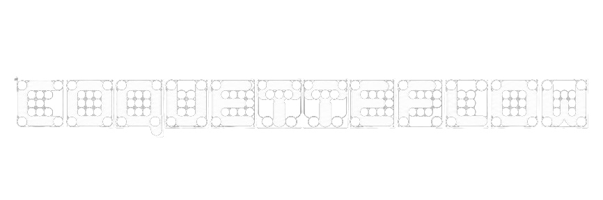
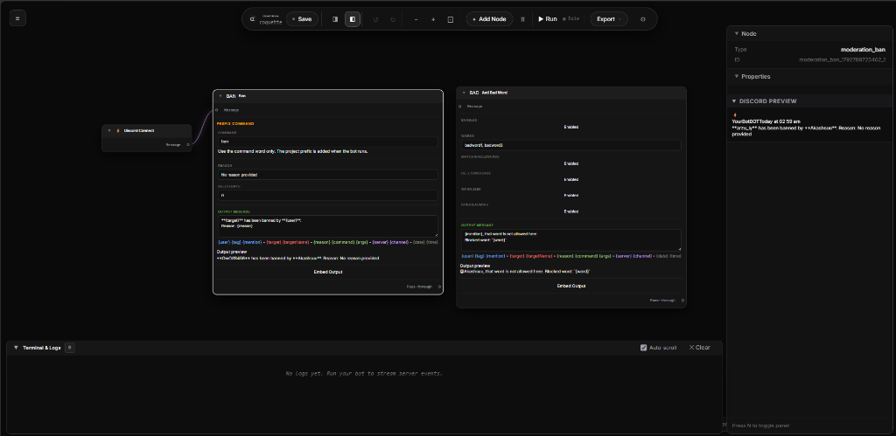
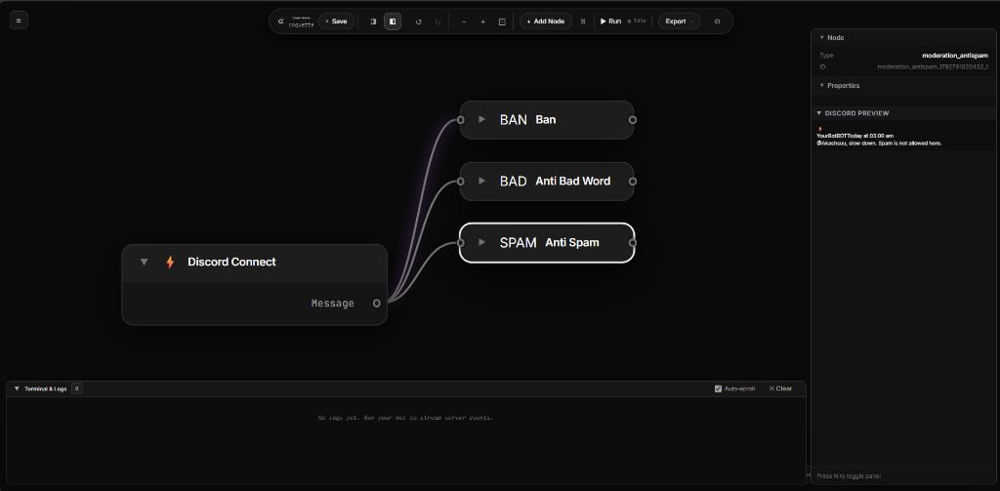
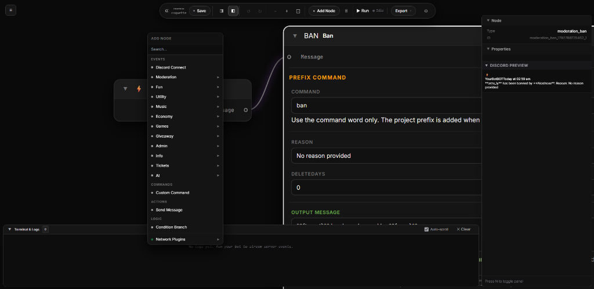
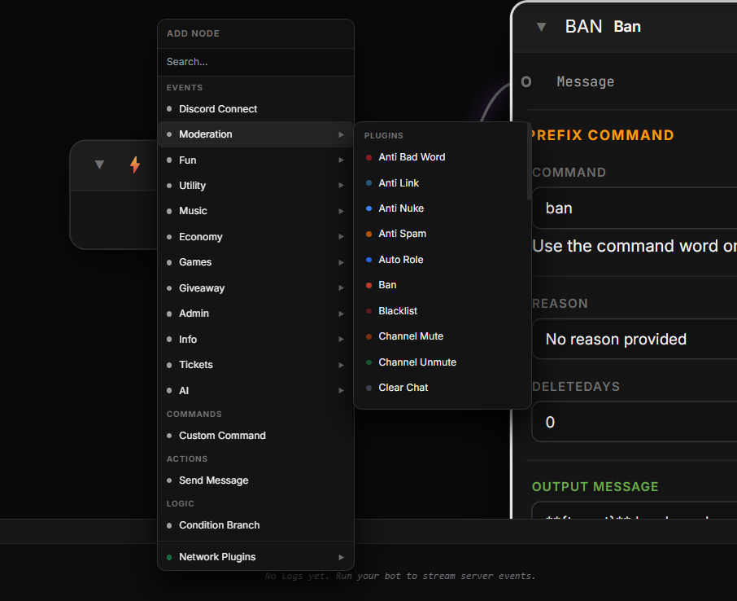

<p align="center">
  
</p>

<p align="center">
  <strong>Minimalist visual Discord bot builder.</strong><br>
  Build, test, run, and export full-featured Discord.js v14 bots using interactive node graphs.
</p>

<p align="center">
  <strong>Live Demo / Test Link:</strong> <a href="https://coquetteflow.bot.nu"><strong>https://coquetteflow.bot.nu</strong></a>
</p>

<p align="center">
  <a href="#live-demo">Live Demo</a> •
  <a href="#screenshots">Screenshots</a> •
  <a href="#features">Features</a> •
  <a href="#getting-started">Getting Started</a> •
  <a href="#web-hosting--deployment">Deployment</a> •
  <a href="#memory-saver--auto-sleep">Memory Saver</a>
</p>

---

## Live Demo

Test the live web edition of CoquetteFlow directly in your browser:

- **URL:** [https://coquetteflow.bot.nu](https://coquetteflow.bot.nu)
- **Status:** Hosted & Online

---

## Screenshots

### 1. Node Canvas & Live Preview
Build bot workflows with floating nodes, clean handles, live Discord embed previews, and real-time event logs.



---

### 2. Curved Connections & Minimized Nodes
Connect triggers to commands, moderation filters, and actions with smooth curved bezier wires. Minimize nodes to maximize canvas focus.



---

### 3. Add Node Context Menu
Right-click anywhere or click **+ Add Node** in the floating toolbar to browse categorized triggers, actions, moderation tools, and utility plugins.

<p align="center">
  
  
</p>

---

## Features

- **Visual Node Editor** — Drag, drop, connect, minimize, and organize nodes on an infinite dot-grid canvas.
- **117+ Modular Plugins** — Built-in moderation (Anti-Spam, Anti-BadWord, Anti-Link, Ban, Kick, Mute), economy, music, utility, and custom command nodes.
- **Live Server Bot Runner** — Test and run your bot in real-time directly on your server or desktop.
- **Auto-Sleep & RAM Saver** — Automatically detects when builders leave or close the website and shuts down idling bots to conserve server RAM.
- **Export Discord.js v14 Code** — Download clean, standard, production-ready `bot.js` code or backup your workflow in `project.json`.
- **Live Discord Preview** — See how embeds, buttons, and message templates will look in Discord before running.
- **Web & Desktop Editions** — Host as a full multi-user web application or run locally as an Electron desktop app.

---

## Tech Stack

| Layer | Technology |
|---|---|
| **Web & API Server** | Node.js, Express, WebSockets (`ws`) |
| **Desktop Shell** | Electron 28 |
| **Frontend Framework** | React 18 |
| **Node Graph Engine** | React Flow 11 |
| **Discord API Client** | Discord.js 14 |
| **Build System** | Webpack 5, Babel, Tailwind CSS |
| **Process Manager** | PM2 / Docker |

---

## Getting Started

### Prerequisites

- [Node.js](https://nodejs.org/) v18.0.0 or higher
- npm v9 or higher

### Installation

```bash
git clone https://github.com/akashsuu/discord-bot-builder.git coquetteflow
cd coquetteflow
npm install
```

### Running as a Hosted Web App

```bash
# 1. Build the frontend bundle
npm run build

# 2. Start the web server
npm start
```

The CoquetteFlow web platform will be accessible at `http://localhost:3000` (or your configured `PORT`).

### Running as Desktop Application (Electron)

```bash
npm run start:electron
```

---

## Web Hosting & Deployment

CoquetteFlow can be hosted on any VPS, cloud server, or container platform.

### Option 1: PM2 (Recommended for VPS)

```bash
# 1. Compile bundle
npm run build

# 2. Start with PM2
pm2 start ecosystem.config.js
pm2 save
```

### Option 2: Docker & Docker Compose

```bash
# Start container in background
docker compose up -d
```

### Option 3: Nginx Reverse Proxy with WebSockets

To point your custom domain (`coquetteflow.bot.nu`) to your instance:

```nginx
server {
    server_name coquetteflow.bot.nu;

    location / {
        proxy_pass http://localhost:44556;
        proxy_http_version 1.1;
        proxy_set_header Upgrade $http_upgrade;
        proxy_set_header Connection "upgrade";
        proxy_set_header Host $host;
        proxy_set_header X-Real-IP $remote_addr;
        proxy_cache_bypass $http_upgrade;
    }
}
```

---

## Memory Saver & Auto-Sleep

When hosting for users online, multiple running bots can quickly consume server RAM. CoquetteFlow features a presence-aware auto-sleep architecture:

- **Active Heartbeat**: The browser sends a keep-alive heartbeat every 8 seconds while building.
- **Instant Unload Beacon**: When a user closes their tab or browser, `navigator.sendBeacon('/api/bot/leave')` instantly alerts the server.
- **Smart Grace Period**: A brief grace countdown prevents bots from stopping during normal page refreshes (`F5`).
- **RAM Reclaimed**: The server destroys the Discord client, clears guild caches, and frees memory back to the operating system.

---

## Keyboard Shortcuts

| Shortcut | Action |
|---|---|
| `N` | Toggle Right Properties / Inspector Panel |
| `Ctrl + S` | Save bot project to server |
| `Ctrl + Z` | Undo last graph modification |
| `Ctrl + Y` | Redo graph modification |
| `Delete` / `Backspace` | Delete selected node(s) or connection wire |
| `Right-Click` | Open Add Node context menu at cursor position |
| `Mouse Wheel` | Zoom in / out on canvas |
| `Middle-Click Drag` | Pan canvas |

---

## Exported Code Example

Clicking **Export > Export bot.js** produces clean Discord.js v14 code:

```javascript
const { Client, GatewayIntentBits } = require("discord.js");

const client = new Client({
  intents: [
    GatewayIntentBits.Guilds,
    GatewayIntentBits.GuildMessages,
    GatewayIntentBits.MessageContent,
  ],
});

client.once("ready", () => {
  console.log(`[CoquetteFlow] Logged in as ${client.user.tag}`);
});

client.on("messageCreate", async (message) => {
  if (message.author.bot) return;

  if (message.content.startsWith("!hello")) {
    message.channel.send(`Hello ${message.author.username}!`);
  }
});

client.login("YOUR_BOT_TOKEN");
```

---

## Plugin System

You can add custom node types by creating a subfolder in `/plugins/`:

```
plugins/
└── my_plugin/
    ├── plugin.json
    └── index.js
```

### `plugin.json`
```json
{
  "name": "My Plugin",
  "version": "1.0.0",
  "description": "Custom moderation or utility node",
  "author": "You",
  "category": "moderation"
}
```

### `index.js`
```javascript
module.exports = {
  nodes: {
    my_plugin_node: {
      async execute(node, message, helpers) {
        // Run logic when message arrives
        return true; // Pass through to downstream nodes
      },
      generateCode(node) {
        return `/* custom generated discord.js code */`;
      }
    }
  }
};
```

---

## License

CoquetteFlow. All rights reserved.
